<div align="center">

# ☀️ SOLAR — a Medallion data platform in Microsoft Fabric

**Seven solar plants · two inverter vendors · 1.18 million readings · one workspace**


</div>

This project takes raw CSV exports from two solar-inverter portals (**Huawei FusionSolar** and **Solis**), and turns them into a tested star schema and an interactive report. It started as a local pandas project and was rebuilt end to end in Microsoft Fabric, with every row count checked against the original.

> 📊 **Interactive presentation:** [open it in your browser](https://pnzavitsanos.github.io/solar-fabric/), with a vendor filter, a plant picker and clickable charts. The file itself is [`docs/solar-presentation.html`](docs/solar-presentation.html) and also works offline.

| | |
|---|---|
| **Energy produced** | 2,201,535 kWh (2.20 GWh) |
| **Readings in silver** | 1,180,215 (5-minute intervals) |
| **Valid after quality rules** | 1,177,533 (99.77%) |
| **Plants / inverters reporting** | 7 / 50 (of 66 registered) |
| **Period** | 27 June 2024 – 31 May 2025 |

---

## Contents

1. [Architecture](#architecture)
2. [The workspace](#the-workspace)
3. [Bronze: land the raw data](#bronze-land-the-raw-data)
4. [Silver: clean, deduplicate, flag](#silver-clean-deduplicate-flag)
5. [Silver checked: enforce the rules](#silver-checked-enforce-the-rules)
6. [Gold: the star schema](#gold-the-star-schema)
7. [Semantic model and DAX](#semantic-model-and-dax)
8. [Results](#results)
9. [Data quality](#data-quality)
10. [Reconciliation with the pandas version](#reconciliation-with-the-pandas-version)
11. [Lessons learned](#lessons-learned)
12. [Repository layout](#repository-layout)
13. [Roadmap](#roadmap)

---

## Architecture

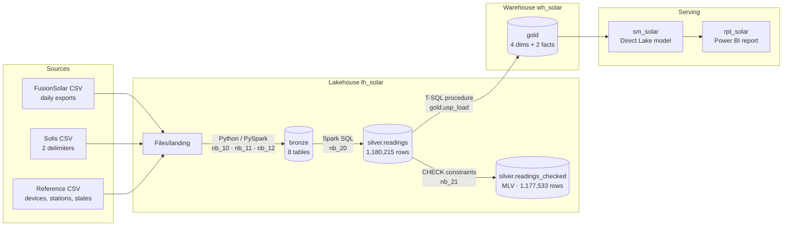

| Layer | Where | Tool | What happens | Rows out |
|---|---|---|---|---|
| Landing | `lh_solar/Files/landing` | upload | Raw CSV files, untouched | 1,234,946 readings |
| Bronze | `lh_solar.bronze` | Python + PySpark | Everything as text, plus `source_file` | 725,604 FS + 509,342 Solis |
| Silver | `lh_solar.silver.readings` | Spark SQL | UTC timestamps, decimals, dedup, 6 quality flags, shared state model | 1,180,215 |
| Silver checked | `lh_solar.silver.readings_checked` | Materialized lake view | Rows that pass all 6 rules | 1,177,533 |
| Gold | `wh_solar.gold` | T-SQL (CTAS in a stored procedure) | 4 dimensions, 2 facts | 8,248 daily rows |
| Serve | `sm_solar`, `rpt_solar` | Direct Lake, DAX, Power BI | Star schema, measures, report | — |

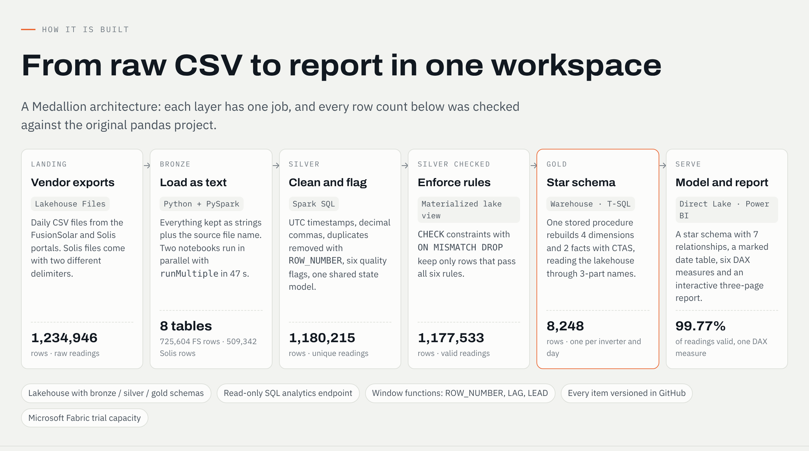

---

## The workspace

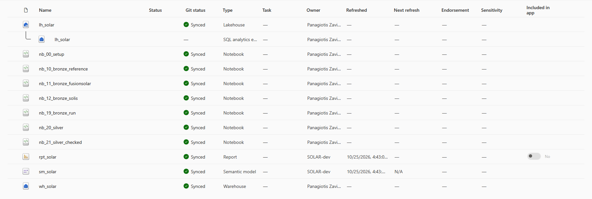

Every item is synced to this repository through **Fabric Git integration** (folder [`fabric/`](fabric/)). Fabric stores each item as text:

| Item | Type | In this repo |
|---|---|---|
| `lh_solar` | Lakehouse (+ SQL analytics endpoint) | `fabric/lh_solar.Lakehouse/` |
| `nb_00_setup` | Notebook (PySpark) | `fabric/nb_00_setup.Notebook/notebook-content.py` |
| `nb_10_bronze_reference` | Notebook (Python) | `fabric/nb_10_bronze_reference.Notebook/notebook-content.py` |
| `nb_11_bronze_fusionsolar` | Notebook (PySpark) | `fabric/nb_11_bronze_fusionsolar.Notebook/notebook-content.py` |
| `nb_12_bronze_solis` | Notebook (PySpark) | `fabric/nb_12_bronze_solis.Notebook/notebook-content.py` |
| `nb_19_bronze_run` | Notebook (PySpark) | `fabric/nb_19_bronze_run.Notebook/notebook-content.py` |
| `nb_20_silver` | Notebook (Spark SQL + PySpark) | `fabric/nb_20_silver.Notebook/notebook-content.py` |
| `nb_21_silver_checked` | Notebook (Spark SQL) | `fabric/nb_21_silver_checked.Notebook/notebook-content.py` |
| `wh_solar` | Warehouse | `fabric/wh_solar.Warehouse/` |
| `sm_solar` | Semantic model (Direct Lake) | `fabric/sm_solar.SemanticModel/` |
| `rpt_solar` | Report | `fabric/rpt_solar.Report/` |

**Naming:** the first digit after `nb_` is the layer (0 setup, 1 bronze, 2 silver), the second is the step, and `9` marks a runner notebook.

The data itself is not in Git, only the item definitions.

---

## Bronze: land the raw data

**Rule for bronze: keep everything as text and record where each row came from.** Types are fixed in silver, so a bad value can never stop a load.

### Schemas — `nb_00_setup`

```sql
%%sql
CREATE SCHEMA IF NOT EXISTS bronze;
CREATE SCHEMA IF NOT EXISTS silver;
CREATE SCHEMA IF NOT EXISTS gold;
```

<details><summary>Screenshot</summary>

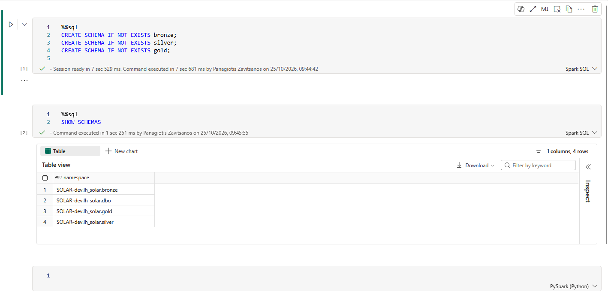

</details>

### Reference tables — `nb_10_bronze_reference` (Python notebook)

Six small CSVs (devices, stations, sources, state mappings) are loaded with pandas and written as Delta tables with `deltalake`. Writing through the `/lakehouse/default` mount fails with *"Unable to rename file"*, so the write goes to the OneLake `abfss://` path with a storage token.

```python
import os
import pandas as pd
from deltalake import write_deltalake

token = notebookutils.credentials.getToken("storage")
options = {"bearer_token": token, "use_fabric_endpoint": "true"}

folder = "/lakehouse/default/Files/landing/reference"
base = "abfss://SOLAR-dev@onelake.dfs.fabric.microsoft.com/lh_solar.Lakehouse/Tables/bronze"

for name in sorted(os.listdir(folder)):
    df = pd.read_csv(f"{folder}/{name}", dtype=str, keep_default_na=False)
    df["source_file"] = name
    table = name.replace(".csv", "")
    write_deltalake(f"{base}/{table}", df, mode="overwrite", storage_options=options)
    print(table, df.shape)
```

| Table | Rows × columns |
|---|---|
| devices | 66 × 8 |
| inverter_state_canonical | 3 × 3 |
| inverter_state_mapping_fusionsolar | 26 × 4 |
| inverter_state_mapping_solis | 3 × 4 |
| source | 2 × 3 |
| stations | 7 × 9 |

<details><summary>Screenshot</summary>

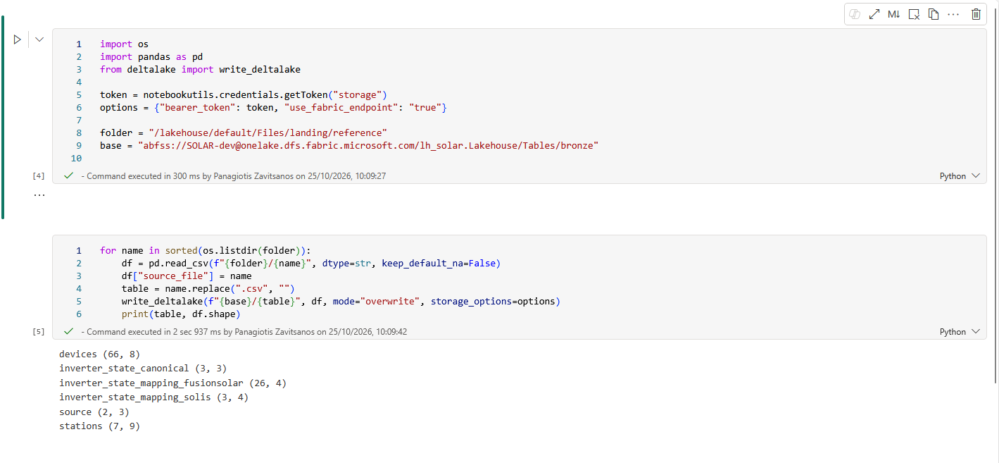

</details>

### FusionSolar readings — `nb_11_bronze_fusionsolar` (PySpark)

```python
from pyspark.sql.functions import col

fs = spark.read.csv("Files/landing/fusionsolar", header=True)
fs = fs.withColumn("source_file", col("_metadata.file_name"))
print(fs.count())                                   # 725604
fs.write.mode("overwrite").saveAsTable("bronze.readings_fusionsolar")
```

<details><summary>Screenshot</summary>

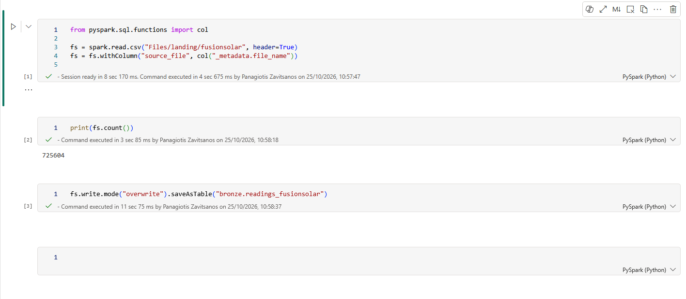

</details>

### Solis readings — `nb_12_bronze_solis` (PySpark)

Solis exports use **two delimiters**: 321 files with commas and 17 with semicolons. The notebook sorts the files by their header line, then reads each group with the right separator.

```python
import os
from pyspark.sql.functions import col

folder = "/lakehouse/default/Files/landing/solis"
comma_files = []
semi_files = []

for name in sorted(os.listdir(folder)):
    with open(f"{folder}/{name}") as f:
        header = f.readline()
    path = f"Files/landing/solis/{name}"
    if ";" in header:
        semi_files.append(path)
    else:
        comma_files.append(path)

print(len(comma_files), len(semi_files))            # 321 17

so_comma = spark.read.csv(comma_files, header=True, sep=",").withColumn("source_file", col("_metadata.file_name"))
so_semi  = spark.read.csv(semi_files,  header=True, sep=";").withColumn("source_file", col("_metadata.file_name"))

so = so_comma.unionByName(so_semi)
print(so.count())                                   # 509342
so.write.mode("overwrite").saveAsTable("bronze.readings_solis")
```

<details><summary>Screenshot</summary>

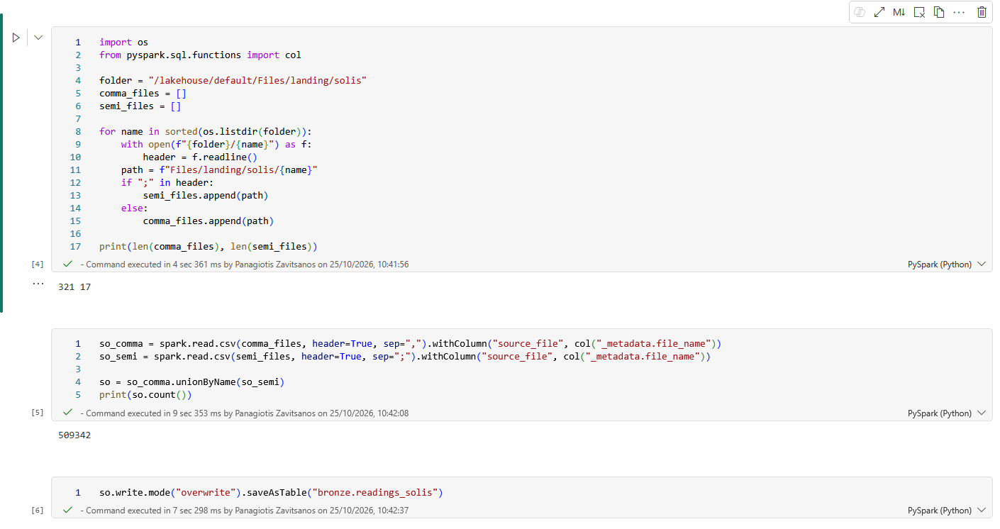

</details>

### Orchestration — `nb_19_bronze_run`

```python
result = notebookutils.notebook.runMultiple(["nb_11_bronze_fusionsolar", "nb_12_bronze_solis"])
```

Both loaders run in parallel on one Spark session: 40.6 s and 43.8 s, **47 s in total**.

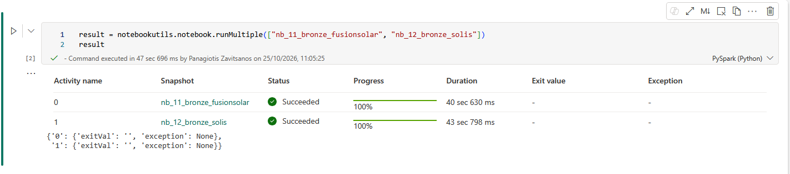

> `runMultiple` needs the children to use the same compute as the parent. A Python-notebook child under a PySpark parent fails with *"JupyterCompute does not match SparkCompute"*, which is why the readings loaders are PySpark notebooks.

---

## Silver: clean, deduplicate, flag

`nb_20_silver` turns the two bronze tables into one typed table, `silver.readings`.

The notebook builds a chain of temporary views, checks the row counts after each step, and writes one Delta table at the end.

**1. Clean each vendor.** Both vendors are mapped to the same column names and units. Decimal commas become dots, and `try_cast` turns bad values into `NULL` instead of failing the load.

```python
spark.sql("SET spark.sql.session.timeZone = UTC")

spark.sql("""
SELECT
  lower(trim(device_id))                               AS device_hash_id,
  timestamp_millis(CAST(collect_time AS BIGINT))       AS ts,
  try_cast(replace(active_power, ',', '.') AS DOUBLE)  AS ac_power_kw,
  try_cast(replace(dc_power, ',', '.') AS DOUBLE)      AS dc_power_kw,
  try_cast(replace(efficiency, ',', '.') AS DOUBLE)    AS efficiency_pct,
  try_cast(replace(day_cap, ',', '.') AS DOUBLE)       AS energy_today_kwh,
  try_cast(replace(total_cap, ',', '.') AS DOUBLE)     AS energy_total_kwh,
  try_cast(replace(temperature, ',', '.') AS DOUBLE)   AS temperature_c,
  inverter_state                                       AS state_code,
  source_file,
  'fusionsolar'                                        AS vendor
FROM bronze.readings_fusionsolar
""").createOrReplaceTempView("fs_clean")
```

Solis is the same shape, with two differences: its timestamps come in **two text formats**, and they are in local time, so one hour is subtracted to get UTC.

```python
spark.sql("""
SELECT
  lower(trim(inverter_id))                              AS device_hash_id,
  coalesce(try_to_timestamp(`timestamp`, 'yyyy-MM-dd HH:mm:ss'),
           try_to_timestamp(`timestamp`, 'dd/MM/yyyy HH:mm:ss')) - INTERVAL 1 HOUR AS ts,
  try_cast(replace(total_ac_power, ',', '.') AS DOUBLE) AS ac_power_kw,
  try_cast(replace(dc_power, ',', '.') AS DOUBLE)       AS dc_power_kw,
  CAST(NULL AS DOUBLE)                                  AS efficiency_pct,
  try_cast(replace(eToday, ',', '.') AS DOUBLE)         AS energy_today_kwh,
  try_cast(replace(eTotal, ',', '.') AS DOUBLE)         AS energy_total_kwh,
  try_cast(replace(temperature, ',', '.') AS DOUBLE)    AS temperature_c,
  state                                                 AS state_code,
  source_file,
  'solis'                                               AS vendor
FROM bronze.readings_solis
""").createOrReplaceTempView("so_clean")
```

**2. Union and deduplicate.** Daily exports overlap, so the same reading can appear in two files. `ROW_NUMBER()` keeps one row per vendor, inverter and timestamp, preferring the newest file.

```sql
%%sql
CREATE OR REPLACE TEMP VIEW readings_clean AS
SELECT * FROM fs_clean
UNION ALL
SELECT * FROM so_clean;

CREATE OR REPLACE TEMP VIEW readings_dedup AS
SELECT * FROM (
  SELECT *,
         ROW_NUMBER() OVER (PARTITION BY vendor, device_hash_id, ts
                            ORDER BY source_file DESC) AS rn
  FROM readings_clean
)
WHERE rn = 1
```

| Vendor | Bronze rows | After dedup |
|---|---:|---:|
| FusionSolar | 725,604 | 693,875 |
| Solis | 509,342 | 486,340 |
| **Total** | **1,234,946** | **1,180,215** |

**3. Flag, don't delete.** Each quality rule becomes a boolean column, so every rule can be counted. The two vendors' state codes are mapped to one shared model (1 = ON, 2 = OFF, 3 = ERROR).

```python
spark.sql("""
SELECT 'fusionsolar' AS vendor, state_id, canonical_state_id FROM bronze.inverter_state_mapping_fusionsolar
UNION ALL
SELECT 'solis' AS vendor, state_id, canonical_state_id FROM bronze.inverter_state_mapping_solis
""").createOrReplaceTempView("states")

spark.sql("""
SELECT device_hash_id, try_cast(max_power AS DOUBLE) AS max_power_kw
FROM bronze.devices
""").createOrReplaceTempView("device_size")
```

```sql
%%sql
CREATE OR REPLACE TEMP VIEW readings_flagged AS
SELECT
  r.device_hash_id, r.ts, r.ac_power_kw, r.dc_power_kw, r.efficiency_pct,
  r.energy_today_kwh, r.energy_total_kwh, r.temperature_c, r.state_code,
  r.source_file, r.vendor,
  d.device_hash_id IS NULL                                   AS unknown_device,
  coalesce(r.temperature_c > 100, false)                     AS bad_temperature,
  coalesce(r.energy_total_kwh = 0, false)                    AS bad_counter,
  s.state_id IS NULL                                         AS unknown_state,
  coalesce(r.ac_power_kw > d.max_power_kw * 2, false)        AS too_much_power,
  coalesce(r.energy_today_kwh > d.max_power_kw * 24, false)  AS bad_energy_today,
  s.canonical_state_id,
  CASE s.canonical_state_id WHEN '1' THEN 'ON' WHEN '2' THEN 'OFF' WHEN '3' THEN 'ERROR' END AS state
FROM readings_dedup r
LEFT JOIN device_size d ON r.device_hash_id = d.device_hash_id
LEFT JOIN states s      ON r.vendor = s.vendor AND r.state_code = s.state_id
```

**4. Write.**

```python
spark.table("readings_flagged").write.mode("overwrite").saveAsTable("silver.readings")
```

---

## Silver checked: enforce the rules

`nb_21_silver_checked` declares the six rules once as constraints on a **materialized lake view**. Rows that break any rule are dropped by the engine.

```sql
%%sql
CREATE MATERIALIZED LAKE VIEW IF NOT EXISTS silver.readings_checked
(
  CONSTRAINT known_device  CHECK (unknown_device   = false) ON MISMATCH DROP,
  CONSTRAINT sane_temp     CHECK (bad_temperature  = false) ON MISMATCH DROP,
  CONSTRAINT counter_not_0 CHECK (bad_counter      = false) ON MISMATCH DROP,
  CONSTRAINT known_state   CHECK (unknown_state    = false) ON MISMATCH DROP,
  CONSTRAINT sane_power    CHECK (too_much_power   = false) ON MISMATCH DROP,
  CONSTRAINT sane_energy   CHECK (bad_energy_today = false) ON MISMATCH DROP
)
AS SELECT * FROM silver.readings
```

**1,180,215 rows in → 1,177,533 rows out.**

---

## Gold: the star schema

Gold lives in the **warehouse** `wh_solar` (schema `gold`), because the lakehouse SQL analytics endpoint is read-only. The warehouse reads silver across databases with three-part names such as `lh_solar.silver.readings`.

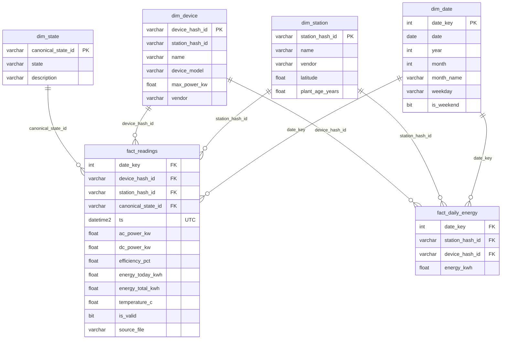

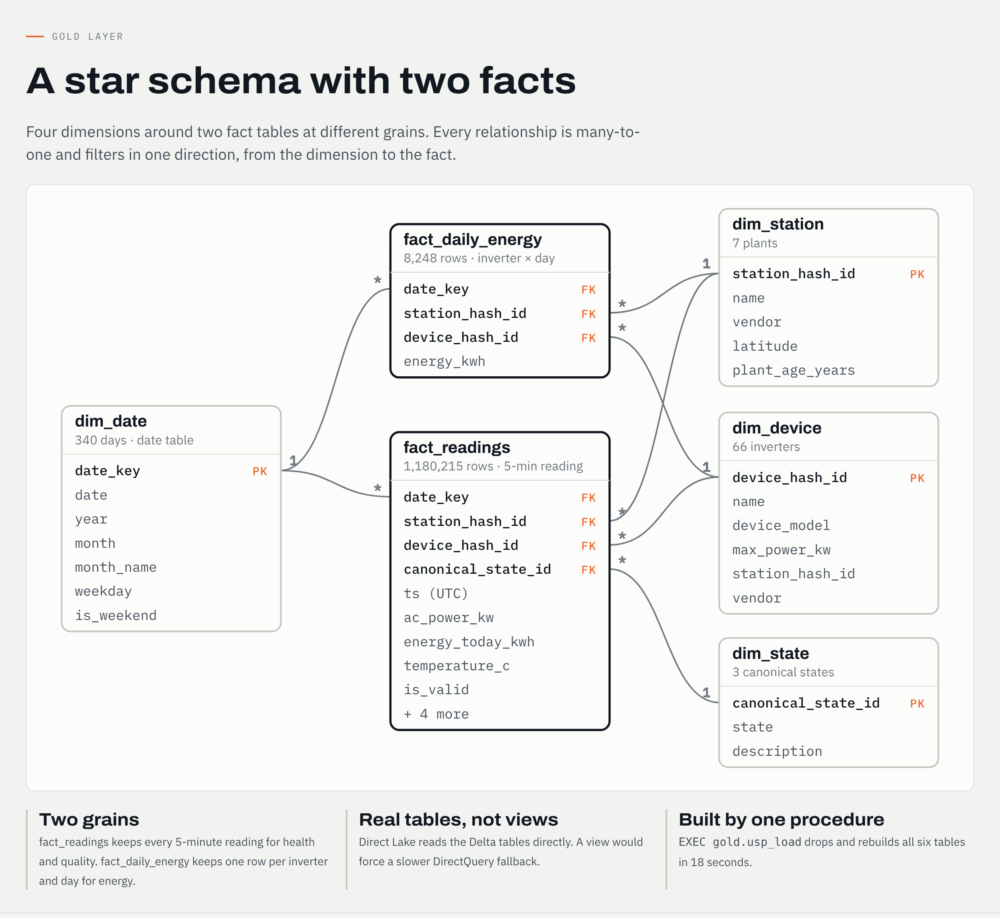

| Table | Grain | Rows |
|---|---|---|
| `dim_state` | one canonical state (ON / OFF / ERROR) | 3 |
| `dim_station` | one plant | 7 |
| `dim_device` | one inverter | 66 |
| `dim_date` | one day, 27 Jun 2024 – 1 Jun 2025 | 340 |
| `fact_readings` | one 5-minute reading of one inverter | 1,180,215 |
| `fact_daily_energy` | one inverter on one day (valid readings only) | 8,248 |

### The load procedure — `gold.usp_load`

One stored procedure rebuilds the whole gold layer with `DROP TABLE IF EXISTS` + `CREATE TABLE AS SELECT`. `EXEC gold.usp_load;` runs in about 18 seconds.

<details>
<summary><b>Full procedure</b> (from <code>fabric/wh_solar.Warehouse/gold/StoredProcedures/usp_load.sql</code>)</summary>

```sql
CREATE PROCEDURE gold.usp_load
AS
BEGIN
    DROP TABLE IF EXISTS gold.dim_state;
    CREATE TABLE gold.dim_state AS
    SELECT canonical_state_id, description,
           CASE canonical_state_id WHEN '1' THEN 'ON' WHEN '2' THEN 'OFF' WHEN '3' THEN 'ERROR' END AS state
    FROM lh_solar.bronze.inverter_state_canonical;

    DROP TABLE IF EXISTS gold.dim_station;
    CREATE TABLE gold.dim_station AS
    SELECT st.station_hash_id, st.name,
           TRY_CAST(NULLIF(st.location_latitude, '') AS float) AS latitude,
           TRY_CAST(NULLIF(st.plant_age_years, '') AS float)   AS plant_age_years,
           LOWER(src.name)                                     AS vendor
    FROM lh_solar.bronze.stations st
    JOIN lh_solar.bronze.source src ON st.source = src.id;

    DROP TABLE IF EXISTS gold.dim_device;
    CREATE TABLE gold.dim_device AS
    SELECT d.device_hash_id, d.station_hash_id, d.name, d.device_model,
           TRY_CAST(NULLIF(d.max_power, '') AS float) AS max_power_kw,
           LOWER(src.name)                            AS vendor
    FROM lh_solar.bronze.devices d
    JOIN lh_solar.bronze.source src ON d.source = src.id;

    DROP TABLE IF EXISTS gold.dim_date;
    CREATE TABLE gold.dim_date AS
    SELECT
      d.[date],
      YEAR(d.[date]) * 10000 + MONTH(d.[date]) * 100 + DAY(d.[date])  AS date_key,
      YEAR(d.[date])                                                  AS [year],
      MONTH(d.[date])                                                 AS [month],
      CAST(DATENAME(month, d.[date]) AS varchar(10))                  AS month_name,
      CAST(DATENAME(weekday, d.[date]) AS varchar(10))                AS weekday,
      CAST(CASE WHEN DATENAME(weekday, d.[date]) IN ('Saturday', 'Sunday')
                THEN 1 ELSE 0 END AS bit)                             AS is_weekend
    FROM (
      SELECT DATEADD(day, a.n + 10 * b.n + 100 * c.n, r.first_day) AS [date], r.last_day
      FROM (VALUES (0),(1),(2),(3),(4),(5),(6),(7),(8),(9)) AS a(n)
      CROSS JOIN (VALUES (0),(1),(2),(3),(4),(5),(6),(7),(8),(9)) AS b(n)
      CROSS JOIN (VALUES (0),(1),(2),(3),(4),(5),(6),(7),(8),(9)) AS c(n)
      CROSS JOIN (SELECT MIN(CAST(ts AS date)) AS first_day,
                         MAX(CAST(ts AS date)) AS last_day
                  FROM lh_solar.silver.readings) AS r
    ) AS d
    WHERE d.[date] <= d.last_day;

    DROP TABLE IF EXISTS gold.fact_readings;
    CREATE TABLE gold.fact_readings AS
    SELECT
      YEAR(r.ts) * 10000 + MONTH(r.ts) * 100 + DAY(r.ts)  AS date_key,
      r.device_hash_id, d.station_hash_id, r.canonical_state_id, r.ts,
      r.ac_power_kw, r.dc_power_kw, r.efficiency_pct,
      r.energy_today_kwh, r.energy_total_kwh, r.temperature_c,
      CAST(CASE WHEN r.unknown_device = 0 AND r.bad_temperature = 0 AND r.bad_counter = 0
                 AND r.unknown_state = 0 AND r.too_much_power = 0 AND r.bad_energy_today = 0
                THEN 1 ELSE 0 END AS bit)                 AS is_valid,
      r.source_file
    FROM lh_solar.silver.readings AS r
    LEFT JOIN gold.dim_device AS d ON r.device_hash_id = d.device_hash_id;

    DROP TABLE IF EXISTS gold.fact_daily_energy;
    CREATE TABLE gold.fact_daily_energy AS
    SELECT date_key, station_hash_id, device_hash_id,
           MAX(energy_today_kwh) AS energy_kwh
    FROM gold.fact_readings
    WHERE is_valid = 1
    GROUP BY date_key, station_hash_id, device_hash_id;
END;
```

</details>

Some details worth pointing out:

- **`dim_date` without a calendar table.** Three `VALUES (0)…(9)` lists cross-joined give the numbers 0–999. Adding them to the first reading date makes one row per day up to the last reading date.
- **`NULLIF(x, '')` before `TRY_CAST`.** In T-SQL, `TRY_CAST('' AS float)` returns 0, not `NULL`.
- **`is_valid`** is the six silver flags folded into one bit, so the report can show valid and invalid readings side by side.
- **`fact_daily_energy`** takes `MAX(energy_today_kwh)`, the inverter's own running total for the day, from valid readings only.

---

## Semantic model and DAX

`sm_solar` is a **Direct Lake** model on the six gold tables: 7 many-to-one relationships, single direction, and `dim_date` marked as the date table.

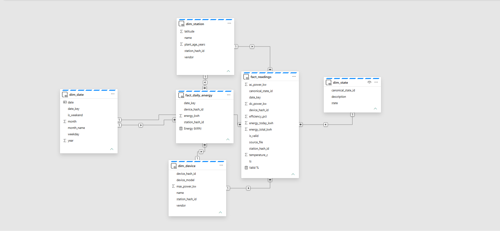

```dax
Energy (kWh) = SUM ( fact_daily_energy[energy_kwh] )

Valid % =
DIVIDE (
    CALCULATE ( COUNTROWS ( fact_readings ), fact_readings[is_valid] = TRUE () ),
    COUNTROWS ( fact_readings )
)

Readings = COUNTROWS ( fact_readings )

-- A plant filter reaches the fact table but not dim_device.
-- Passing the fact table as a filter keeps only inverters that actually reported.
Installed kW = CALCULATE ( SUM ( dim_device[max_power_kw] ), fact_daily_energy )

Days with data = DISTINCTCOUNT ( fact_daily_energy[date_key] )

Yield (kWh/kW/day) = DIVIDE ( [Energy (kWh)], [Installed kW] * [Days with data] )
```

The report `rpt_solar` has three pages: **Energy** (cards, daily energy, energy per plant, vendor slicer), **Inverter health** (state donut) and **Monthly heatmap** (plant × month matrix with conditional formatting, plus an installed-power vs yield scatter).

---

## Results

All charts below come from the interactive presentation in [`docs/solar-presentation.html`](docs/solar-presentation.html), built from the gold tables.

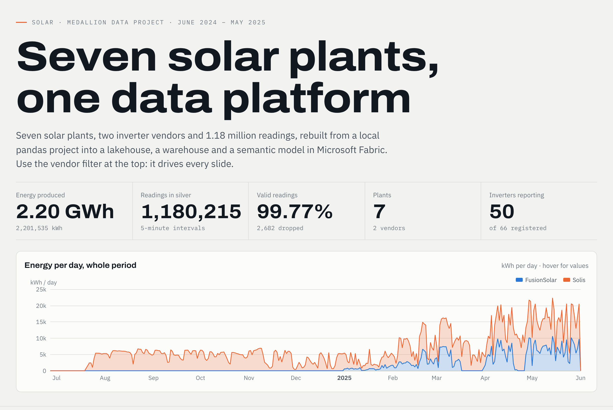

### Daily energy

Solis data starts on 27 June 2024 and FusionSolar on 1 January 2025. Output roughly triples from January to May. The best day was **14 May 2025 with 22,353 kWh** across both vendors.

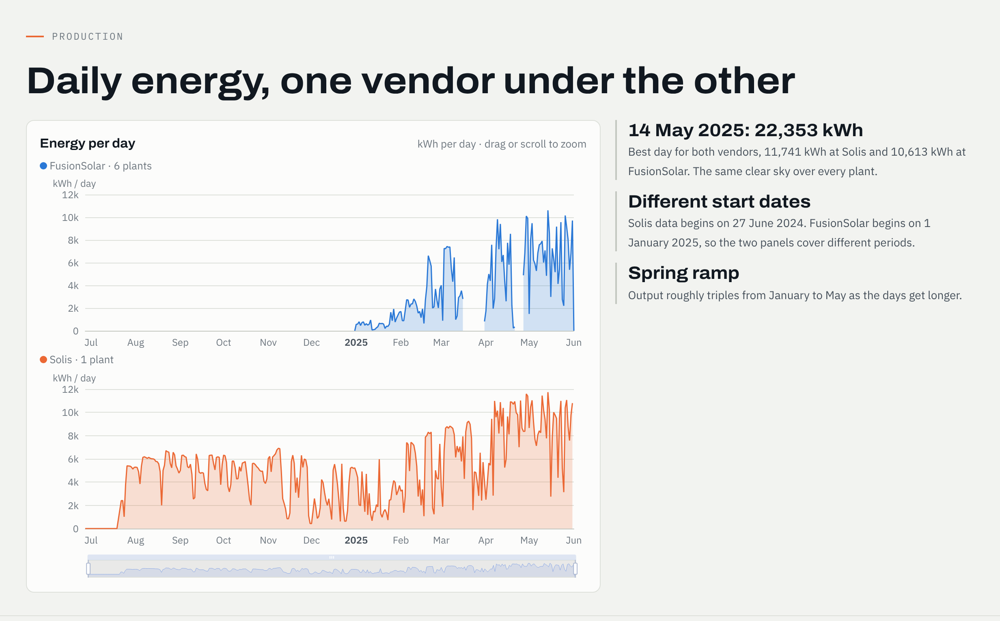

### Energy per plant

| Plant | Vendor | Energy (kWh) | Installed (kW) | Days with data | Yield (kWh/kW/day) |
|---|---|---:|---:|---:|---:|
| SOLIS Station 1 | Solis | 1,688,064.70 | 1,300 | 337 | 3.85 |
| FUSIONSOLAR Station 5 | FusionSolar | 162,862.57 | 605 | 133 | 2.02 |
| FUSIONSOLAR Station 1 | FusionSolar | 145,958.77 | 605 | 132 | 1.83 |
| FUSIONSOLAR Station 6 | FusionSolar | 98,696.95 | 440 | 133 | 1.69 |
| FUSIONSOLAR Station 4 | FusionSolar | 77,080.54 | 220 | 133 | 2.63 |
| FUSIONSOLAR Station 3 | FusionSolar | 15,923.27 | 44 | 120 | 3.02 |
| FUSIONSOLAR Station 2 | FusionSolar | 12,948.56 | 44 | 123 | 2.39 |
| **Total** | | **2,201,535.36** | | | |

One Solis plant makes **76.7%** of all the energy.

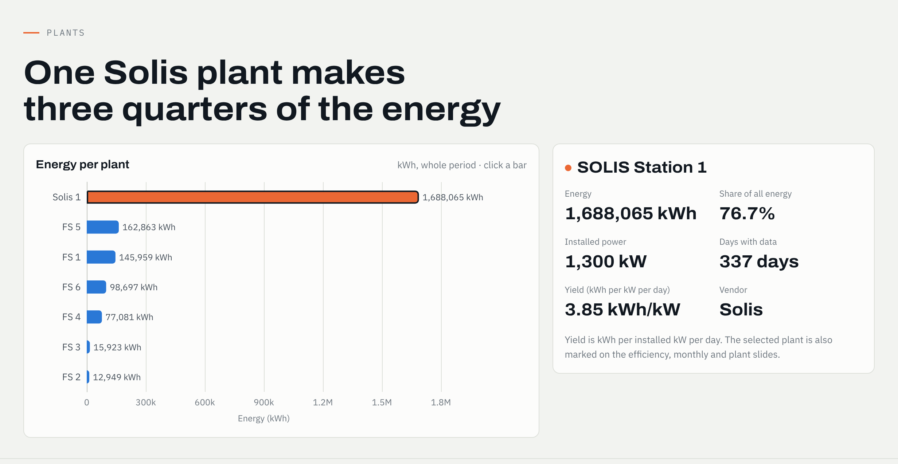

### Efficiency

Yield divides energy by installed power and by days with data, so plants of different size and age can be compared. The smallest FusionSolar plant (FS 3, 44 kW) yields more per kW than the two big ones (FS 1 and FS 6), which makes those the first candidates for a site visit.

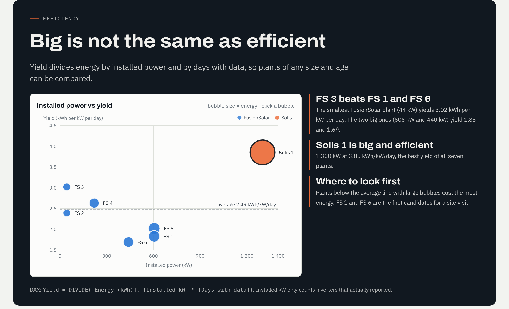

### Monthly heatmap

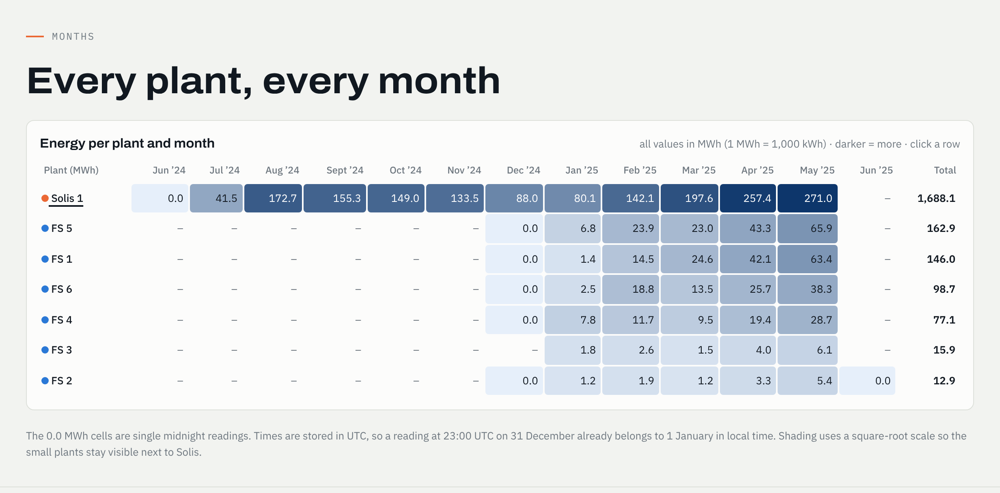

The 0.0 MWh cells are single midnight readings: times are stored in UTC, so a reading at 23:00 UTC on 31 December already belongs to 1 January in local time.

### An average day

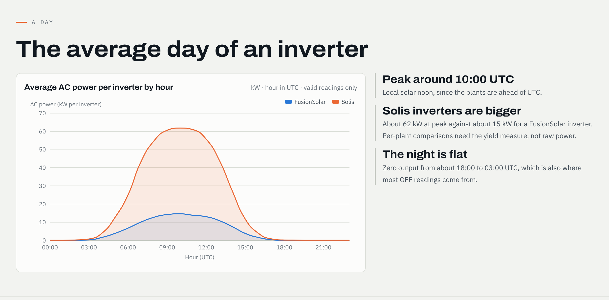

### Inverter health and quality checks

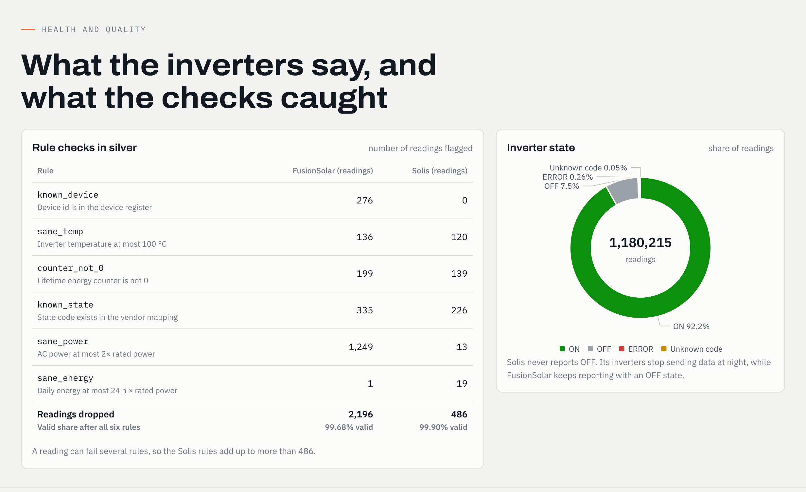

---

## Data quality

Six rules are computed as flags in silver and enforced in `silver.readings_checked`:

| Rule | Catches | FusionSolar | Solis |
|---|---|---:|---:|
| `known_device` | device id not in the device register | 276 | 0 |
| `sane_temp` | inverter temperature above 100 °C | 136 | 120 |
| `counter_not_0` | lifetime energy counter reads 0 | 199 | 139 |
| `known_state` | state code not in the vendor mapping | 335 | 226 |
| `sane_power` | AC power above 2 × rated power | 1,249 | 13 |
| `sane_energy` | daily energy above 24 h × rated power | 1 | 19 |
| **Readings dropped** | any rule | **2,196** | **486** |
| **Valid share** | | **99.68%** | **99.90%** |

A reading can break several rules, so the Solis rules add up to more than 486.

**Inverter states** (all readings): ON 1,087,592 (92.15%), OFF 89,012 (7.54%), ERROR 3,050 (0.26%), unknown code 561 (0.05%). Solis never reports OFF: its inverters stop sending data at night, while FusionSolar keeps reporting with an OFF state.

---

## Reconciliation with the pandas version

Every layer was checked against the original local pandas pipeline.

| Check | pandas | Fabric |
|---|---:|---:|
| FusionSolar rows after dedup | 693,875 | 693,875 |
| Solis rows after dedup | 486,340 | 486,340 |
| Silver rows | 1,180,215 | 1,180,215 |
| Valid rows | 1,177,533 | 1,177,533 |
| Daily energy rows | 8,248 | 8,248 |
| Total energy (kWh) | 2,201,535.36 | 2,201,535.36 |
| SOLIS Station 1, May 2025 (kWh) | 271,033.10 | 271,033.10 |

---

## Lessons learned

| Topic | What happened | What works |
|---|---|---|
| Empty strings | Spark reads an empty CSV field as `NULL`, but T-SQL `TRY_CAST('' AS float)` returns **0**. | Wrap it: `TRY_CAST(NULLIF(x, '') AS float)`. |
| NULL logic | `temperature_c > 100` is *unknown* when the value is NULL, and unknown is not false. | `coalesce(temperature_c > 100, false)` for every flag. |
| Time zones | Midnight readings in UTC land in the wrong local month (the 0.0 kWh cells in the heatmap). | Store UTC, add a local-time column in silver. |
| Lakehouse writes from Python | `deltalake` cannot write through the `/lakehouse/default` mount. | Write to the `abfss://` OneLake path with a storage token. |
| Spark SQL temp views | In a schema-enabled lakehouse, a `%%sql` temp view over `bronze.x` breaks when another view references it (*"Failed to decode multipart name"*). | Create it in PySpark: `spark.sql("SELECT …").createOrReplaceTempView("name")`. |
| Warehouse types | `nvarchar` is not supported in Fabric Warehouse tables. | `CAST(DATENAME(...) AS varchar(10))`. |
| Re-runnable gold | CTAS fails if the table exists. | `DROP TABLE IF EXISTS` before each CTAS, inside one procedure. |
| Endpoint vs warehouse | The lakehouse SQL analytics endpoint is read-only. | Writes, procedures and CTAS go to the warehouse. |
| Direct Lake | Views in the model force DirectQuery fallback. | Gold is built as real tables. |
| DAX filter direction | A plant filter does not reach `dim_device`, so `SUM(max_power_kw)` showed 3,423 kW for every plant. | `CALCULATE(SUM(dim_device[max_power_kw]), fact_daily_energy)`. |
| Capacity | An idle Spark session held the trial capacity, and new runs failed with error 430. | Monitoring hub → stop the session. |

---

## Repository layout

```
.
├── README.md                     ← this file
├── docs/
│   ├── solar-presentation.html   ← interactive presentation (works offline)
│   └── img/                      ← screenshots and chart images used here
└── fabric/                       ← synced by Fabric Git integration (do not edit by hand)
    ├── lh_solar.Lakehouse/
    ├── nb_00_setup.Notebook/
    ├── nb_10_bronze_reference.Notebook/
    ├── nb_11_bronze_fusionsolar.Notebook/
    ├── nb_12_bronze_solis.Notebook/
    ├── nb_19_bronze_run.Notebook/
    ├── nb_20_silver.Notebook/
    ├── nb_21_silver_checked.Notebook/
    ├── wh_solar.Warehouse/
    ├── sm_solar.SemanticModel/
    └── rpt_solar.Report/
```

### Run it yourself

1. Create a Fabric workspace and connect it to this repository (Workspace settings → Git integration, folder `fabric`). The items appear in the workspace.
2. Upload the CSV exports to `lh_solar` → `Files/landing/{reference, fusionsolar, solis}`.
3. Run `nb_00_setup`, `nb_10_bronze_reference`, then `nb_19_bronze_run`.
4. Run `nb_20_silver`, then `nb_21_silver_checked`.
5. In `wh_solar`, run `EXEC gold.usp_load;`.
6. Open `rpt_solar`.

---

## Roadmap

- [ ] **Pipeline:** one Data Factory pipeline for bronze → silver → gold → model refresh, on a daily schedule with retries and failure alerts.
- [ ] **Incremental loads:** `MERGE` into silver instead of full overwrites.
- [ ] **Local time:** a local-time column next to the UTC timestamp.
- [ ] **Row-level security:** a vendor role on `dim_station`.
- [ ] **Real-time:** an Eventstream and a KQL database with tumbling-window aggregations for a live inverter feed.

---

<sub>Built while preparing for the Microsoft DP-700 exam (Fabric Data Engineer Associate).</sub>
